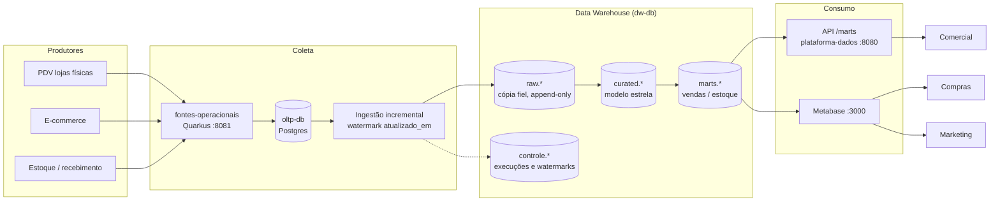

# Diagrama da arquitetura de dados

> **Responsável:** Romulo · **Critério:** diagrama arquitetural (20%)
> Meta "Avançado": completo, legível e coerente, **com legenda**.

O diagrama abaixo é o **ponto de partida** da base. O Romulo completa com as tabelas `curated`/`marts`
definitivas, os consumidores, a legenda e exporta um PNG em `docs/img/arquitetura.png`.

## Legenda

<!-- TODO (Romulo): formas (retângulo = serviço, cilindro = armazenamento), cores por camada,
     linha cheia = fluxo de dados, tracejada = metadados/controle, frequência de cada seta. -->

## Componentes

<!-- TODO (Romulo): tabela componente → tecnologia → responsabilidade → container/porta. -->
