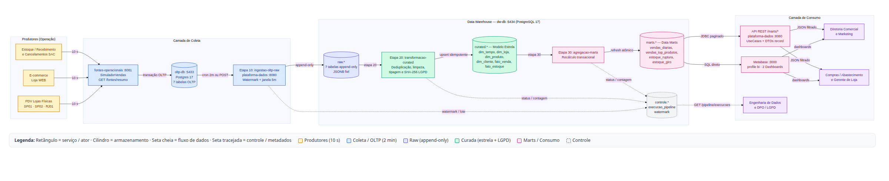

# Diagrama da arquitetura de dados

> **Responsável:** Romulo · **Critério:** diagrama arquitetural (20%)
> Meta "Avançado": completo, legível e coerente, **com legenda**.

A arquitetura da **FarmaRede** separa o ambiente operacional (`oltp-db`) da plataforma analítica (`dw-db`),
orquestrada em containers Docker Compose. Cada bloco de execução abaixo corresponde a um serviço real
em [`docker-compose.yml`](../docker-compose.yml) e aos schemas criados pelas migrations Flyway.

```mermaid
flowchart LR
  classDef produtor fill:#FEF3C7,stroke:#D97706,color:#78350F,stroke-width:1.5px
  classDef coleta fill:#DBEAFE,stroke:#2563EB,color:#1E3A8A,stroke-width:1.5px
  classDef raw fill:#E0E7FF,stroke:#4F46E5,color:#312E81,stroke-width:1.5px
  classDef curated fill:#D1FAE5,stroke:#059669,color:#064E3B,stroke-width:1.5px
  classDef marts fill:#FCE7F3,stroke:#DB2777,color:#831843,stroke-width:1.5px
  classDef controle fill:#F3F4F6,stroke:#4B5563,color:#1F2937,stroke-dasharray: 4 2
  classDef consumidor fill:#F3E8FF,stroke:#7C3AED,color:#4C1D95,stroke-width:1.5px

  subgraph Produtores["Produtores (Operação)"]
    PDV[PDV Lojas Físicas<br/>SP01 · SP02 · RJ01]:::produtor
    ECOM[E-commerce<br/>Loja WEB]:::produtor
    EST[Estoque / Recebimento<br/>e Cancelamentos SAC]:::produtor
  end

  subgraph Coleta["Camada de Coleta"]
    FO[fontes-operacionais :8081<br/>SimuladorVendas<br/>GET /fontes/resumo]:::coleta
    OLTP[(oltp-db :5433<br/>Postgres 17<br/>7 tabelas OLTP)]:::coleta
    ING[Etapa 10: ingestao-oltp-raw<br/>plataforma-dados :8080<br/>Watermark + janela 5m]:::coleta
  end

  subgraph DW["Data Warehouse — dw-db :5434 (PostgreSQL 17)"]
    RAW[(raw.*<br/>7 tabelas append-only<br/>JSONB fiel)]:::raw
    TR[Etapa 20: transformacao-curated<br/>Deduplicação, limpeza,<br/>tipagem e SHA-256 LGPD]:::curated
    CUR[(curated.* — Modelo Estrela<br/>dim_tempo, dim_loja, dim_produto,<br/>dim_cliente, fato_venda, fato_estoque)]:::curated
    AG[Etapa 30: agregacao-marts<br/>Recálculo transacional]:::marts
    MARTS[(marts.* — Data Marts<br/>vendas_diarias, vendas_top_produtos,<br/>estoque_ruptura, estoque_giro)]:::marts
    CTRL[(controle.*<br/>execucao_pipeline<br/>watermark)]:::controle
  end

  subgraph Consumo["Camada de Consumo"]
    API[API REST /marts/*<br/>plataforma-dados :8080<br/>UseCases + DTOs record]:::marts
    MB[Metabase :3000<br/>profile bi · 2 Dashboards]:::marts
    COM[Diretoria Comercial<br/>e Marketing]:::consumidor
    COMP[Compras / Abastecimento<br/>e Gerente de Loja]:::consumidor
    ENG[Engenharia de Dados<br/>e DPO / LGPD]:::consumidor
  end

  PDV -->|10 s| FO
  ECOM -->|10 s| FO
  EST -->|10 s| FO
  FO -->|transação OLTP| OLTP
  OLTP -->|cron 2m ou POST| ING
  ING -->|append-only| RAW
  RAW -->|etapa 20| TR
  TR -->|upsert idempotente| CUR
  CUR -->|etapa 30| AG
  AG -->|refresh atômico| MARTS

  ING -.->|watermark / lote| CTRL
  TR -.->|status / contagem| CTRL
  AG -.->|status / contagem| CTRL
  CTRL -.->|GET /pipeline/execucoes| ENG

  MARTS -->|JDBC paginado| API
  MARTS -->|SQL direto| MB
  MB -->|dashboards| COM
  MB -->|dashboards| COMP
  API -->|JSON filtrado| COMP
  API -->|JSON filtrado| COM
```

## Legenda

- **Formas dos nós:**
  - **Retângulo (`[...]`):** serviço executável, etapa de processamento ou ator (produtor/consumidor).
  - **Cilindro (`[(...)]`):** armazenamento persistente em banco de dados ou schema PostgreSQL.
  - **Caixas agrupadoras (`subgraph`):** estágios da arquitetura (*Produtores*, *Coleta*, *Data Warehouse* e *Consumo*).
- **Cores por camada:**
  - **Âmbar:** produtores operacionais (PDV, e-commerce, estoque/SAC).
  - **Azul:** camada de coleta e banco transacional (`fontes-operacionais`, `oltp-db` e Etapa 10).
  - **Índigo:** camada **Raw** (`raw.*`, cópia fiel e imutável).
  - **Verde:** camada **Curada** (`curated.*` + Etapa 20, modelo estrela e LGPD).
  - **Rosa:** camada **Agregada / Data Marts** (`marts.*` + Etapa 30 + interfaces de consumo API e Metabase).
  - **Cinza (borda tracejada):** governança e controle do pipeline (`controle.*`).
  - **Lilás:** consumidores finais de negócio e equipe técnica.
- **Setas e frequência:**
  - **Linha cheia (`──►`):** fluxo principal de dados de negócio (coleta a cada **10 s** no simulador; pipeline incremental a cada **2 min** via `PIPELINE_CRON` ou sob demanda via `POST /pipeline/execucoes`; leitura em tempo de consulta na API/BI).
  - **Linha tracejada (`- -►`):** fluxo de metadados, controle de lote, watermark (`controle.*`) e auditoria operacional (`GET /pipeline/execucoes`).

## Componentes

| Componente | Tecnologia | Responsabilidade | Container / Porta |
|------------|------------|------------------|-------------------|
| `oltp-db` | PostgreSQL 17 | Banco operacional (fonte transacional do PDV, e-commerce e estoque) | `oltp-db` / `5433` (host) |
| `dw-db` | PostgreSQL 17 | Data Warehouse com schemas `raw`, `curated`, `marts` e `controle` | `dw-db` / `5434` (host) |
| `fontes-operacionais` | Java 21 + Quarkus | Simula vendas, baixas, reposições, cancelamentos e novos clientes; expõe `GET /fontes/resumo` | `fontes-operacionais` / `8081` |
| `plataforma-dados` | Java 21 + Quarkus | Orquestra as etapas 10, 20 e 30 do pipeline e expõe a API `/pipeline` e `/marts` | `plataforma-dados` / `8080` |
| `metabase` | Metabase `v0.65.4` | BI visual conectado ao `dw-db` (`marts`/`curated`) com dashboards de Vendas e Estoque | `metabase` / `3000` (profile `bi`) |
