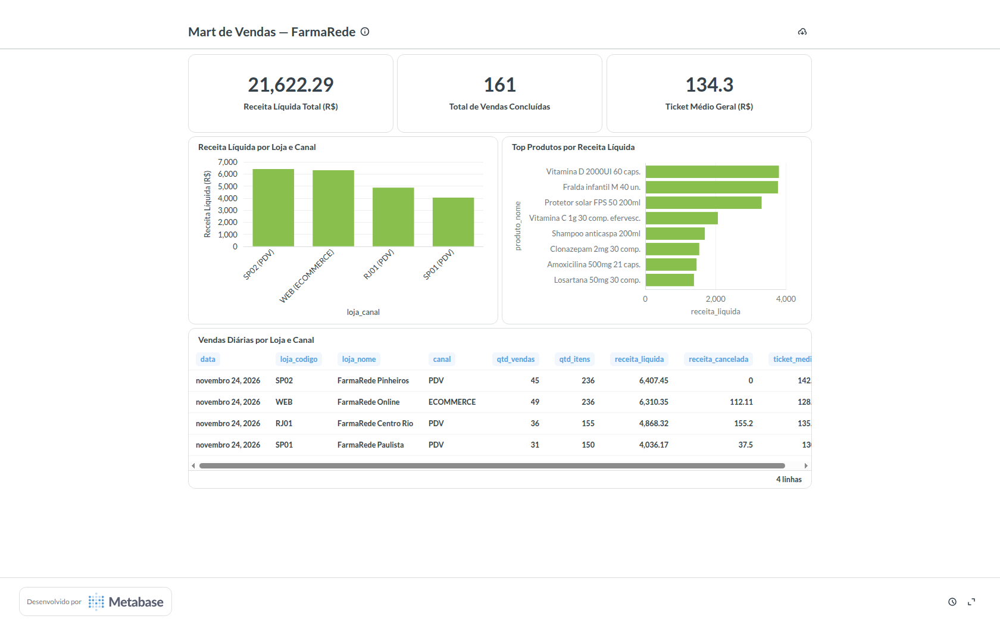
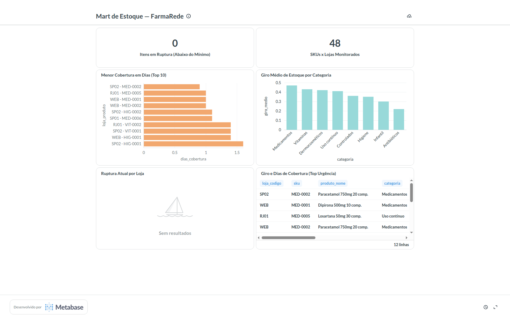

# Data Marts

> **Responsável:** Romulo · **Critério:** definição dos Data Marts (15%)
> Meta "Avançado": relevantes e bem pensados (o enunciado pede **pelo menos 2**).

Os Data Marts da **FarmaRede** ficam no schema `marts` do `dw-db` (migration
[`V250__marts.sql`](../plataforma-dados/src/main/resources/db/migration/V250__marts.sql)) e são
recalculados a cada execução do pipeline pela etapa 30 (`agregacao-marts`). Eles atendem a dois
domínios principais de decisão — **Vendas** e **Estoque** — sem expor dados pessoais de clientes.

## Mart de Vendas

- **Público:** Diretoria comercial, marketing e gerentes de loja.
- **Perguntas respondidas:**
  - Qual a receita líquida, o volume de vendas e o ticket médio por dia, loja e canal (`PDV` × `ECOMMERCE`)?
  - Quais produtos e categorias lideram em receita e quantidade vendida no período?
  - Qual o impacto financeiro de vendas canceladas e descontos por loja/canal?
- **Tabelas e grão:**
  - `marts.vendas_diarias` — **grão:** `(data, loja_codigo, canal)`.
    - **Métricas:** `qtd_vendas` (vendas não canceladas), `qtd_itens`, `receita_bruta`,
      `receita_liquida` (exclui `CANCELADA`), `receita_cancelada` e `ticket_medio`.
  - `marts.vendas_top_produtos` — **grão:** `(periodo, sku)`, onde `periodo` está no formato `YYYY-MM`.
    - **Métricas:** `qtd_vendas`, `qtd_vendida`, `receita_liquida`, `ranking_categoria` e
      `ranking_geral`.
- **Endpoints da API REST (`plataforma-dados :8080`):**
  - `GET /marts/vendas/diarias` — filtros opcionais `de`, `ate` (`YYYY-MM-DD`), `loja` (código, ex.:
    `SP01`), `canal` (`PDV` ou `ECOMMERCE`), `pagina` e `tamanho` (padrão 50, máximo 100).
  - `GET /marts/vendas/top-produtos` — filtros opcionais `categoria`, `periodo` (`YYYY-MM`),
    `limite` (padrão 50, máximo 100) e `pagina`.
- **Dashboard no Metabase:**



## Mart de Estoque

- **Público:** Compras / abastecimento e gerentes de loja.
- **Perguntas respondidas:**
  - Quais produtos estão abaixo do estoque mínimo em cada loja agora (ruptura)?
  - Qual é o déficit de reposição por loja e SKU para priorizar pedidos?
  - Qual o giro de estoque nos últimos 30 dias e quantos dias de cobertura o saldo atual garante?
- **Tabelas e grão:**
  - `marts.estoque_ruptura` — **grão:** `(loja_codigo, sku)` contendo apenas itens cujo último
    saldo conhecido está abaixo do mínimo (`quantidade_saldo < estoque_minimo`).
    - **Métricas:** `data_referencia`, `quantidade_saldo`, `estoque_minimo` e
      `deficit` (`estoque_minimo - quantidade_saldo`).
  - `marts.estoque_giro` — **grão:** `(loja_codigo, sku)` com base no último saldo conhecido e nas
    vendas não canceladas na janela móvel de até 30 dias até `data_referencia`.
    - **Métricas:** `quantidade_saldo`, `estoque_minimo`, `qtd_vendida_30d`, `media_diaria_vendas`,
      `giro_estoque` (`qtd_vendida_30d / quantidade_saldo`) e `dias_cobertura`
      (`quantidade_saldo / media_diaria_vendas`, nulo quando não há vendas no período).
- **Endpoints da API REST (`plataforma-dados :8080`):**
  - `GET /marts/estoque/ruptura` — filtros opcionais `loja`, `pagina` e `tamanho` (padrão 50,
    máximo 100), ordenado por maior `deficit`.
  - `GET /marts/estoque/giro` — filtros opcionais `loja`, `categoria`, `pagina` e `tamanho`
    (padrão 50, máximo 100), ordenado por maior `giro_estoque`.
- **Dashboard no Metabase:**



## Exemplos de consulta

### Mart de Vendas

```sql
-- Receita líquida, vendas concluídas, cancelamentos e ticket médio por loja e canal
SELECT data, loja_codigo, canal, qtd_vendas, receita_liquida, receita_cancelada, ticket_medio
FROM marts.vendas_diarias
ORDER BY data DESC, receita_liquida DESC;
```

```bash
curl "http://localhost:8080/marts/vendas/diarias?loja=SP01&tamanho=20"
curl "http://localhost:8080/marts/vendas/top-produtos?categoria=Medicamentos&limite=5"
```

### Mart de Estoque

```sql
-- Itens abaixo do estoque mínimo e menor cobertura em dias por loja
SELECT loja_codigo, sku, produto_nome, quantidade_saldo, estoque_minimo,
       (estoque_minimo - quantidade_saldo) AS deficit
FROM marts.estoque_ruptura
ORDER BY deficit DESC;

SELECT loja_codigo, sku, produto_nome, quantidade_saldo, qtd_vendida_30d,
       giro_estoque, dias_cobertura
FROM marts.estoque_giro
WHERE dias_cobertura IS NOT NULL
ORDER BY dias_cobertura ASC
LIMIT 10;
```

```bash
curl "http://localhost:8080/marts/estoque/ruptura?loja=SP01"
curl "http://localhost:8080/marts/estoque/giro?categoria=Medicamentos&tamanho=20"
```
